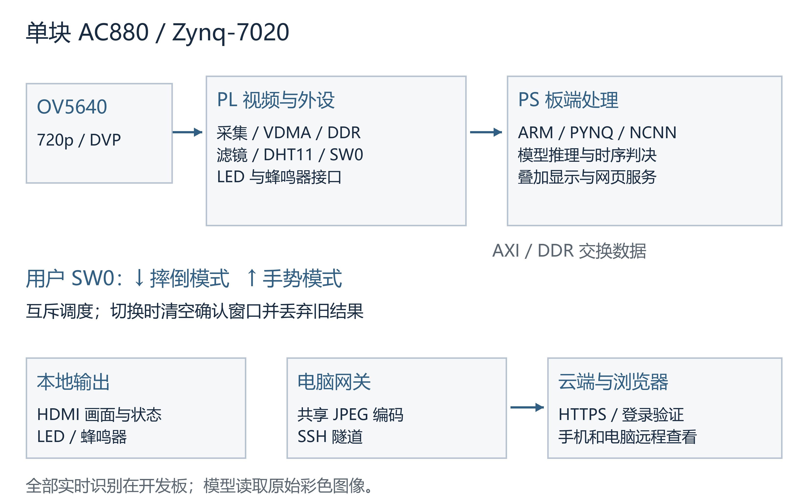
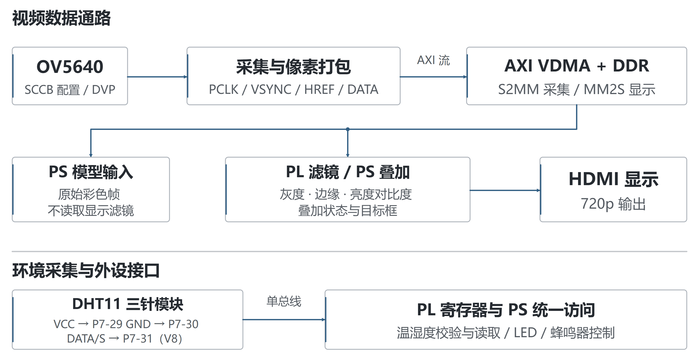
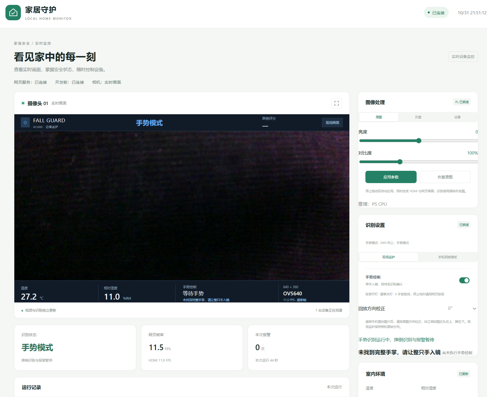
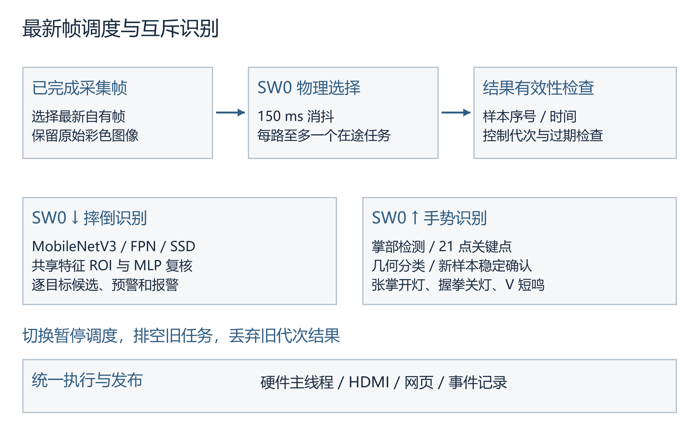
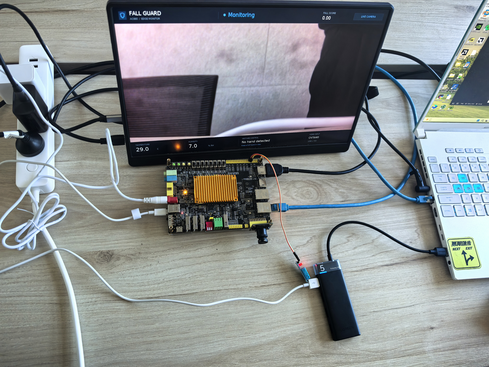
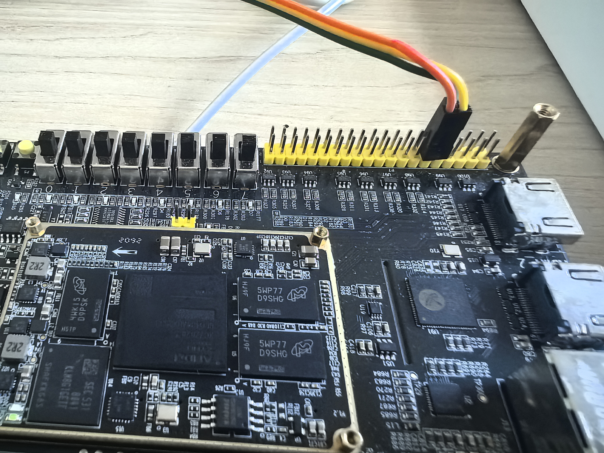

# 跌倒识别与环境智控系统

### 摘要

本作品面向室内安全监护场景，采用单块 AC880 开发板与 OV5640 摄像头，集成跌倒识别报警、手势控制、环境数据显示、本地显示和远程视频访问。系统发挥 Zynq-7020 的 PS 与 PL 协同能力：PL 完成摄像头采集、视频搬运、图像处理及外设接口，PS 在开发板本地执行神经网络推理与时序判决，形成采集、识别、显示和控制的一体化链路。识别使用原始彩色图像，无需预先采集无人背景。

摔倒网络采用轻量骨干、多尺度候选检测与共享特征区域复核，不同目标分别维护报警状态。用户 SW0 互斥选择摔倒或手势任务，切换时清空确认窗口并丢弃旧结果。手势支持张掌开灯、握拳关灯与 V 短鸣，稳定确认和单次触发限制持续重复控制。显示链路与识别独立调度，网页采用共享编码与转发。

系统已实现 1280×720 摄像头与 HDMI 输出、PL 灰度及 Sobel 处理、亮度和对比度调节、DHT11 温湿度显示，以及受登录保护的 HTTPS 网页。网页采用 640×360 视频与浏览器独立文字叠加，兼顾画面传输与状态信息可读性。一次 60 秒公网接收记录为 583 帧，约 9.76 FPS；96 项软件回归通过，配套硬件完成综合、实现和 SW0 接口仿真验证。

## 第一部分 作品概述

### 1.1 功能与特性

系统通过 OV5640 采集室内画面，在 AC880 上完成区域复核与时序报警，状态同步至 HDMI 和网页。DHT11 温湿度实时显示；张掌点亮 8 颗 LED，握拳关灯，V 短鸣 0.5 秒。SW0 选择摔倒或手势任务。网页可手动控制外设、查询报警记录、提交反馈和调节图像处理参数，使用 HTTPS 登录访问。程序手动启动。

### 1.2 应用领域

作品适用于居家看护、室内值守和嵌入式视觉教学展示。使用者可通过 HDMI 查看现场画面、识别状态和温湿度，也可通过手机或电脑远程查看视频与设备状态。手势控制提供非接触交互方式，将视觉识别与 LED、蜂鸣器等外设动作结合，展示端侧智能监测和环境交互的完整应用。

### 1.3 主要技术特点

采用 PS 与 PL 分工实现视频、推理和控制协同：PL 承担连续视频数据通路及外设时序，PS 使用 ARM NCNN 执行 FP32 推理。摔倒复核复用检测骨干特征，减少额外网络计算；不同目标分别确认报警，重复及过期结果不推进状态。SW0 互斥选择手势或摔倒任务，每路最多一个在途任务，切换时丢弃旧结果。显示滤镜只作用于输出，模型始终读取原始彩色图像。远程网关共享 JPEG 编码，云端按观看需求拉取一路视频，再向多个客户端分发。

### 1.4 主要性能指标

| 项目 | 当前结果 |
| --- | --- |
| 摄像头与 HDMI | 1280×720 |
| 远程视频 | 640×360，60 秒约 9.76 FPS |
| 公网视频负载 | 约 1.13 Mbps，单路样本 |
| 手势确认 | 稳定 0.5 秒且至少两个新样本 |
| 软件回归 | 96 项通过 |
| PL 资源 | LUT 23.78%，BRAM 20% |

### 1.5 主要创新点

（1）将跌倒、手势和环境显示整合到单板，形成视频、判决与外设控制闭环。

（2）复用检测骨干的多尺度特征完成区域复核，并为不同目标分别维护时序状态；通过 SW0 互斥选择识别任务，使两类视觉交互具有明确的工作模式。

（3）将显示、模型任务与远程分发解耦，通过最新帧调度和共享视频减少积压。

### 1.6 设计流程

设计依次完成摄像头采集与 HDMI 视频通路、板端检测与时序报警、温湿度采集、手势控制和 HTTPS 网页。软件回归、RTL 自检、完整硬件构建及上板记录共同支撑接口与功能验证；最新帧调度和共享视频分发贯穿采集、显示与远程访问链路。

## 第二部分 系统组成及功能说明

### 2.1 整体介绍

系统由板端采集与处理、电脑视频网关、云端访问入口和浏览器四部分组成。AC880 是唯一的实时识别设备。OV5640 的 DVP 数据经 PL 采集后写入 DDR，PS 从已完成的帧缓冲区取得原始画面，按用户 SW0 状态提交摔倒或手势任务。判决完成后由硬件主线程统一执行外设控制和显示更新，HTTP 线程不直接操作寄存器。

图 1 系统整体结构与数据流

板端服务向电脑网关提供 RGB565 视频与设备状态，电脑完成共享 JPEG 编码后通过 SSH 隧道转发。香港云端使用 Nginx 提供 HTTPS 和登录验证，视频转发器将一路上游 MJPEG 分发给多个观看端。开发板承担全部实时识别，电脑网关、中继和云端承担视频、状态及控制信息的传输，形成清晰的端侧处理与远程访问分工。

### 2.2 硬件系统介绍

#### 2.2.1 硬件整体介绍

核心平台为 AC880，器件型号为 xc7z020clg484-2。Zynq-7020 在同一器件内包含 ARM Cortex-A9 处理系统和 FPGA 可编程逻辑，二者通过 AXI 接口及共享 DDR 交换数据[1]。全部实时识别在该板 PS 侧执行。

PL 侧实现 OV5640 初始化、DVP 采集、像素转换、AXI 视频搬运、显示输出和外设接口；PS 侧运行 PYNQ/Linux 与应用程序，加载配对 bit/hwh 文件，管理物理缓冲区与模型任务。该分工将连续视频和接口时序交由硬件组织，模型推理、时序判决与交互服务由 ARM 软件实现。

| 部件 | 作用 | 连接与数据 |
| --- | --- | --- |
| AC880 | 采集、推理、显示及控制 | ARM PS 与 FPGA PL 协同 |
| OV5640 | 彩色视频采集 | DVP 像素与同步信号，SCCB 配置 |
| HDMI 显示器 | 本地画面和状态显示 | 720p 视频输出 |
| DHT11 模块 | 温湿度采集 | 3.3V、GND、单总线 DATA |
| 用户 LED 与蜂鸣器 | 手动、手势和报警输出 | 由板端统一控制 |
| 电脑与网络 | 编码、网页网关及隧道 | 编码、网页服务与网络传输 |

#### 2.2.2 机械设计介绍

系统采用开发板、摄像头和传感器模块组合搭建。摄像头固定取景，开发板周围预留供电、网络、HDMI 和传感器接线空间，模块布局便于观察接口状态和演示外设动作。整机照片与 P7 接线实拍见第三部分。

#### 2.2.3 电路各模块介绍

摄像头初始化模块经 SCCB 配置 OV5640。DVP_Capture 根据 PCLK、VSYNC、HREF 与像素数据形成视频流，经 FIFO 和像素打包后送入 VDMA。AXI4-Stream 使用有效、就绪及行帧边界信号传递图像，VDMA 在流接口与 DDR 帧缓冲区之间搬运数据[2]。采集与显示使用独立缓冲区，减少 CPU 标注与相机写入相互覆盖。

图 2 采集显示与外设接口

图像处理链路保留原图、灰度和 Sobel 边缘模式，支持亮度及对比度调节。软件先准备 DMA 接收端，再启动发送端，并在完成后发布显示帧。滤镜不改写模型使用的原始彩色快照。显示文字和识别框在处理后的图像上叠加，以保持状态信息可读。

DHT11 使用三针模块，VCC 接 P7-29 的 3.3V，GND 接 P7-30，DATA/S 接 P7-31，对应 FPGA V8。PL 约每 5 秒完成一次采样与校验，软件读取有效状态和缓存值，并将温湿度同步显示在 HDMI 和网页。读数有效性与过期处理使界面能够区分当前采样状态和历史读数。

### 2.3 软件系统介绍

#### 2.3.1 软件整体介绍

板端软件按硬件接入、推理、判决、显示和服务划分。manage.py 负责手动启动及进程状态；realtime.py 持有硬件资源并驱动主循环；SharedFallDetector 与 HandModels 分别封装检测和手势模型；TrackedFallDetector 与 GestureController 处理时序；home_web.py 提供状态、视频及控制接口。

图 3 当前网页监控与控制界面

图 3 为实际运行页面截屏，展示视频、连接状态、图像处理参数、当前模式、温湿度和手势提示。网页采用独立文字层呈现状态，使文字清晰度与视频压缩参数分别控制；同时提供 LED、蜂鸣器、报警历史和反馈入口。控制请求经过校验后由硬件主线程统一应用。

电脑网关只保留一份上游原始视频和共享 JPEG 结果。香港视频服务只监听回环地址，并由 Nginx 统一对外发布；无观看者时停止持续拉流，慢客户端跳过旧帧。HTTPS 提供传输保护，登录验证覆盖页面、状态、视频及控制路由，控制请求另校验令牌，防止仅凭跨站请求改变设备状态。

#### 2.3.2 软件各模块介绍

主循环在摄像头出帧后管理视频缓冲区和模型任务。模型忙碌时保留最新帧，结果返回后检查样本序号、源时间和控制代次。显示任务在模型推理期间独立更新，持续呈现新的画面。退出时按视频、DMA、物理缓冲区的顺序释放资源，统一管理硬件访问与内存所有权。

图 4 最新帧调度与判决流程

摔倒网络输入为 320×192。图像按比例缩放与补边后归一化，使用 NCNN 在 ARM 上执行 FP32 推理[3]。网络采用 MobileNetV3-Large 特征骨干、FPN 多尺度融合和三个 SSD 检测头，解码后恢复候选框坐标。区域复核器共享骨干特征，通过 1920→128→6 的 MLP 完成区域分类，并组合当前与参考复核结果筛选候选，减少重复骨干计算。

当前任务由用户拨码 SW0 选择：向下执行摔倒识别，向上执行手势识别。PL 两级同步后经 AXI 只读寄存器提供电平，软件消抖 150 ms。任务调度结合代次编号、在途任务排空和确认窗口重置，使识别结果与当前物理模式保持对应。视频显示、环境采集和网页手动控制独立运行。

时序判决为 IDLE、CANDIDATE、ALARM_ARMED、ALARM 四级。当前候选确认参数为 0.4 秒，预警保持参数为 0.8 秒；实际响应还受模型周期和新鲜证据到达时间影响。各目标分别维护状态，重复、过期或不相干目标的结果不用于累积同一报警。报警事件写入结构化记录，可关联截图供事后复核；反馈不直接自动训练或修改在线阈值。

手势分支采用掌部检测与 21 点关键点模型[4-5]。根据指节夹角、指尖相对距离和两指间距区分张掌、握拳及 V。V 主要检查食指和中指伸展分开、无名指和小指折叠，避免拇指被遮挡时直接否决。每个控制动作要求稳定 0.5 秒且至少两个新样本；同一姿势持续保持仅触发一次，V 短鸣保留冷却间隔。手机回放测试模式暂停手势控制，并允许手动校正画面方向；现场监护保持原始方向。

| 核心模块 | 关键输入 | 处理内容 |
| --- | --- | --- |
| VDMAManager | 摄像头帧索引、帧地址 | 自有原始帧与可发布显示帧 |
| ConcurrentGestureInference | 新帧与采样时间 | SW0 互斥调度与结果代次隔离 |
| SharedFallDetector | RGB 图像、模型文件 | 候选框、得分、复核标签 |
| TrackedFallDetector | 新鲜检测结果 | 各目标状态与报警事件 |
| GestureController | 手势、序号与时间 | 单次 LED 或有限时长蜂鸣命令 |
| HomeOutputs | 网页或手势命令 | 经校验的控制状态，主线程执行 |
| SharedVideo 与转发器 | 自有帧或 MJPEG | 共享最新帧，限制缓存积压 |

训练工具位于 ac880_fall/ml，板端源码位于 board_runtime/app，部署脚本与云端配置位于 ac880_fall/scripts 和 ac880_fall/cloud。训练以实际 FallDataset 为基础，补充公共数据及相机负例。CAUCAFall 用于补充姿态和取景变化[6]，URFall 回放用于开发回归[7]。训练、开发回归和真实人员验收分别记录。

## 第三部分 完成情况及性能参数

### 3.1 整体介绍

系统已完成从摄像头采集到本地显示、板端识别、外设响应和公网访问的链路集成。程序使用独立运行目录，启动脚本提供 run、status、stop，采用手动启动。运行不依赖先拍摄空背景。

整机照片

### 3.2 工程成果

#### 3.2.1 机械成果

已完成开发板、OV5640、HDMI 显示器与外设的模块式搭建，以及摄像头固定、供电和主要线缆连接。实物布局便于展示摄像头输入、本地输出、传感器接线和 LED、蜂鸣器的控制效果。

#### 3.2.2 电路成果

已接通 OV5640、HDMI、DHT11、LED 和蜂鸣器，形成视频与外设处理链路。网页可提交并回读图像处理参数，显示侧提供原图、灰度、Sobel、亮度及对比度调节，模型侧保留原始彩色输入。DHT11 校验、采样状态和过期读数处理同步接入本地与网页界面。

P7 接口与外设接线实拍

#### 3.2.3 软件成果

板端已部署摔倒识别、手势控制和网页服务，远程网址为 https://shuaidao.online。网页登录后可查看视频与状态，执行外设控制并查看报警记录。公网检查确认 HTTP 跳转 HTTPS、TLS 证书有效，以及未登录访问和缺少控制令牌的请求按规则受到保护。共享视频分发和重连处理支持远程观看链路。

### 3.3 特性成果与测试结果

验证由软件回归、固定样本回归、SW0 RTL 自检、硬件构建、上板记录和公网视频接收组成。96 项软件回归覆盖坐标恢复、重复帧过滤、结果新鲜度、控制所有权、手势分类、DMA 排空、像素一致性和网页访问控制；各类记录按对应样本、接口和测试条件分别保存。

| 测试项目 | 条件 | 结果 |
| --- | --- | --- |
| 软件回归 | 执行 ac880_fall/tests/test_*.py | 96 项通过 |
| 公网视频 | 60 秒，外部 HTTPS 接收端，另有本地观看端 | 583 帧，约 9.76 FPS |
| 视频间隔 | 同一 60 秒样本 | 最大约 0.265 秒 |
| 视频负载 | 同一接收端，JPEG 纯载荷 | 平均约 14.4 KB/帧，1.13 Mbps |
| 状态轮询 | 同期采集 41 次 | 无请求错误，设备均就绪 |
| 访问验证 | 页面、资源、视频等 8 条未登录路由 | 均返回 401；缺少控制令牌返回 403 |

表中视频结果对应一次 60 秒公网接收记录，状态接口同期采集 41 次。固定开发样本回归保留了 32 图中原有的 11 个匹配倒地框。视频接收、模型样本回归与软件逻辑检查分别记录，便于从传输、识别和控制三个层面查看验证结果。

PL 资源与时序数据取自 Vivado 2025.2 对当前 SW0 配套设计的布线报告。报告同时保留资源占用、约束时钟和已约束路径的 setup、hold 裕量，便于对应到具体配置文件及硬件构建结果。

| 资源与时序 | 结果 |
| --- | --- |
| Slice LUT | 12649 / 53200，23.78% |
| 寄存器 | 17256 / 106400，16.22% |
| BRAM | 28 / 140，20.00% |
| DSP | 24 / 220，10.91% |
| 已约束路径 setup / hold 裕量 | +0.007 ns / +0.036 ns |

当前设计使用 LUT 12649、寄存器 17256、BRAM 28、DSP 24，分别占器件资源的 23.78%、16.22%、20.00% 和 10.91%。已约束路径 setup 与 hold 裕量分别为 +0.007 ns 和 +0.036 ns。原始综合、实现和时序记录位于工程包 build/reports。

## 第四部分 总结

### 4.1 系统功能与设计优势

系统将视频采集、板端识别、环境采样、外设控制和远程访问集成在单块 AC880 平台。PS 与 PL 按数据通路和控制职责分工，模型在 ARM 本地运行，实时识别无需由电脑或云端代算。共享特征区域复核和逐目标时序判决构成摔倒处理链路，SW0 互斥选择提供明确的识别模式。

### 4.2 心得体会

工程实现围绕连续视频与结果调度组织模块。采集、原始图像快照、显示图像和推理结果分别管理，图像处理与状态叠加作用于显示侧，模型始终读取原始彩色画面。硬件主线程统一访问外设，网页线程提交经校验的命令，使视频、识别与交互具有清晰的接口关系。

最新帧调度控制任务排队，视频显示与推理分别更新。电脑网关共享视频接收与 JPEG 编码，云端共享上游视频并按观看需求分发；浏览器独立绘制状态文字。这些设计将板端计算、视频传输和界面呈现分开组织，支持多端查看和清晰的信息展示。

手势控制将掌部检测、21 点关键点、几何分类和稳定确认串联，分别对应张掌开灯、握拳关灯和 V 手势短鸣。同一手势持续保持仅触发一次，SW0 切换结合消抖、代次隔离与窗口清空，使视觉交互与设备动作形成一致的控制流程。

源码采用统一启动入口和模块目录，配套保存 bit/hwh、模型、NCNN 库、文件哈希、构建脚本与验证记录。项目还提供通用运行包校验与 PYNQ DMA 排障技能，工程组织既服务现场演示，也便于查看设计依据、运行步骤和接口验证。

## 第五部分 参考文献

[1] AMD. Zynq 7000 SoC Technical Reference Manual UG585[EB/OL]. Version 1.15, 2026[2026-10-29]. https://docs.amd.com/r/en-US/ug585-zynq-7000-SoC-TRM.

[2] AMD. AXI Video Direct Memory Access v6.3 Product Guide PG020[EB/OL]. 2022[2026-10-29]. https://docs.amd.com/r/en-US/pg020_axi_vdma.

[3] Tencent. ncnn[CP/OL]. Source commit e54f7b1f88434e1d844ea0551b880a1cfb079ce1[2026-10-29]. https://github.com/Tencent/ncnn.

[4] OpenCV. OpenCV Zoo Hand Pose Estimation from MediaPipe[CP/OL]. Source commit 48b10fa505aeb51fbd127fc60a5c660040e823b7[2026-10-29]. https://github.com/opencv/opencv_zoo.

[5] ZHANG F, BAZAREVSKY V, VAKUNOV A, et al. MediaPipe Hands On-device Real-time Hand Tracking[EB/OL]. 2020[2026-10-29]. https://arxiv.org/abs/2006.9614.

[6] ERASO J C, MUÑOZ E, MUÑOZ M, et al. Dataset CAUCAFall[DS/OL]. Version 4, 2022[2026-10-29]. DOI:10.17632/7w7fccy7ky.4.

[7] KĘPSKI M. UR Fall Detection Dataset[DS/OL]. [2026-10-29]. https://fenix.ur.edu.pl/~mkepski/ds/uf.html.

## 附录 工程复现与协作记录

### A1 识别模式与上板记录

用户 SW0 向下为摔倒模式，向上为手势模式。PL 两级同步后由 AXI 寄存器提供电平，软件消抖 150 ms。切换时暂停提交新任务，排空并丢弃旧代次结果，清空确认窗口，结束旧报警或短鸣。环境采集、画面和网页手动控制持续运行。

2026-10-31 的上板记录显示，新配对 bit/hwh 已加载，摄像头就绪，SW0=1 读回正确，手势模式下摔倒推理停用。用户确认 HDMI 与网页画面完整。对应启动回执位于 board/results，可与模型文件清单和硬件配置文件共同查阅。

### A2 视频参数配置与实测记录

| 20 秒公网记录 | 接收帧率 | 纯载荷 | 最大帧间隔 |
| --- | --- | --- | --- |
| 基准配置 | 9.35 FPS | 1.24 Mbps | 0.328 s |
| 18 FPS 显示探索 | 12.83 FPS | 2.34 Mbps | 0.235 s |

表中为两组各 20 秒的公网参数探索记录，分别采集对应配置的视频接收帧率、纯载荷和帧间隔。系统最终采用显示上限 12 FPS、网页发送上限 15 FPS、640×360 视频与 JPEG75，状态文字由浏览器独立呈现。原始参数、接收样本和条件记录位于 data/validation。

硬件资源记录按构建阶段分类：基准资源报告为布局阶段，当前资源报告为布线阶段。报告文件包含阶段、器件、时钟和资源统计，便于对照具体工程配置；当前布线资源见正文资源与时序表。

### A3 技能包与提炼过程

skill 目录提供通用运行包清单校验器和 PYNQ DMA 排障流程。校验器使用 Python 标准库，执行文件路径、大小、哈希、缺失项及大小写冲突检查，可复用于具有 manifest.json 的其他 PYNQ 工程。当前 50 项静态运行文件校验和文件篡改反向检查均得到预期结果。

技能包从 Overlay 配对、完整工程重建、DMA 缓冲区管理、MMIO 线程所有权和部署目录权限等实践中提炼检查步骤，将接口契约、验证入口和文件一致性组织为可复用流程。使用方法、原始观察及验证记录保存在 skill 目录。

### A4 大模型协作与工程验证

开发使用 Codex 辅助接口核对、源码整理、测试组织、构建反馈分析与技术文档编写。真实提示词、模型回答和自我纠错记录随工程包 report/llm_collaboration.md 提交，相关验证结果与构建日志共同构成可追溯的协作记录。

用户需求节选：“能不能把手势识别与摔倒识别用开发板上面的拨码开关来切换”。模型回答节选：“已从厂商手册确认，板上有独立的用户拨码开关，可以用 SW0（第 0 位）切换。”据此完成接线核对、模式互斥、消抖及结果代次隔离。

结合综合工具反馈，工程重建脚本补齐两个已有时钟 IP 的导出，并完成综合、实现和 bit/hwh 配套生成。软件回归与 SW0 RTL 自检用于核对切换逻辑，体现需求、接口、代码和工具验证衔接的工程流程。

图像采集与帧缓冲检查结合启动回执和实际显示结果进行核对，上板后由用户确认 HDMI 与网页画面完整。对应交互记录和实测回执提供了软件验证、工具构建与实际输出之间的关联。

### A5 部署步骤与文件组织

部署由 AC880、OV5640、DHT11、HDMI、电源、网线及配套 PYNQ/Linux 环境组成。配置 NumPy、OpenCV、Pillow 和配套 ARMv7 NCNN 库后，运行 skill/overlay_bundle_check.py board_runtime 核验文件，将完整 board_runtime 放入运行目录，赋予 run.sh 执行权限并手动启动。

硬件使用 Vivado 2025.2，运行 hardware/current/scripts/build.tcl 可重建工程，追加 bitstream 生成配置文件。所有构建和缓存放 E 盘。软件回归位于 ac880_fall/tests，RTL 自检位于 hardware/current/simulation，综合实现报告位于 build/reports，上板回执位于 board/results。电脑网关和云端服务分别按 docs/reproduce.md、ac880_fall/cloud/readme_cn.md 设置网络与自有凭据。

本包原创代码经授权采用 MIT；第三方 RTL、库、字体、数据和模型仍遵守各自条件，许可范围见 license_scope.md。公开源码仓库地址为 https://github.com/Field9527/FPGA_project。
